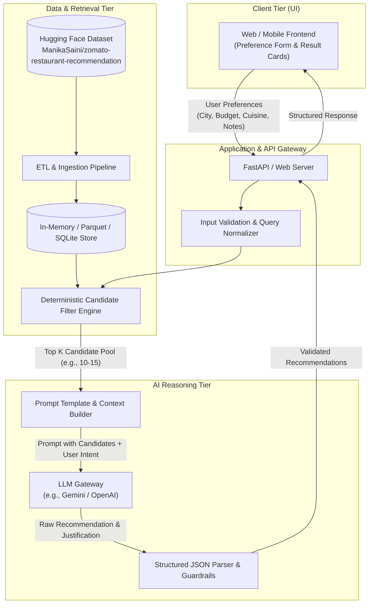
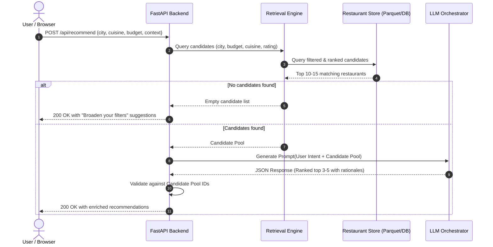

# System Architecture: AI-Powered Restaurant Recommendation System

## 1. System Overview
The **AI-Powered Restaurant Recommendation System** is designed as a hybrid recommendation engine. It pairs deterministic structured filtering (for location, cuisine, pricing, and ratings) with Large Language Model (LLM) cognitive reasoning to deliver personalized, explainable, and grounded dining suggestions based on the Zomato dataset.



---

## 2. Architectural Layers & Component Details

### 2.1 Presentation Layer (Frontend)
- **Role**: Collects user inputs with sensible defaults and delivers a rich, interactive viewing experience.
- **Key Capabilities**:
  - **Filter Controls**: Select city/locality, budget range (Low / Medium / High), cuisine multi-select, minimum rating slider.
  - **Contextual Search Input**: Free-form text box for vibes/occasions (e.g., *"quiet romantic rooftop for an anniversary"*, *"kid-friendly brunch with outdoor play"*).
  - **Results Grid / Cards**: Displays ranked recommendations featuring Restaurant Name, Location, Cuisine, Cost for Two, Rating, and an **"AI Why You'll Love This"** explanation badge.
  - **Fallback State**: Helpful guidance when query constraints yield zero matching records.

---

### 2.2 API & Controller Layer
- **Framework**: **FastAPI** (Python 3.10+)
- **Endpoints**:
  - `GET /health`: Health-check and dataset readiness status.
  - `GET /api/metadata`: Returns available locations, cuisines, and budget tiers for frontend dropdowns.
  - `POST /api/recommend`: Main recommendation endpoint accepting structured preferences and returning ranked, explainable results.

#### API Contract (`POST /api/recommend`)
**Request Payload**:
```json
{
  "location": "Bangalore",
  "budget": "Medium",
  "cuisine": ["Italian", "Continental"],
  "min_rating": 4.0,
  "context": "Quiet romantic dinner with candle-light ambiance",
  "max_results": 5
}
```

**Response Payload**:
```json
{
  "status": "success",
  "query_summary": "Looking for Italian/Continental in Bangalore within Medium budget (4.0+ rating) for a romantic dinner",
  "total_candidates_evaluated": 12,
  "recommendations": [
    {
      "rank": 1,
      "name": "Chianti Italian Restaurant",
      "location": "Koramangala, Bangalore",
      "cuisine": "Italian, Pizza, Pasta",
      "rating": 4.5,
      "cost_for_two": "₹1,500",
      "budget_tier": "Medium",
      "why_recommended": "Chianti offers an intimate, dim-lit ambiance with classic Italian wine pairings, matching your romantic dinner criteria perfectly within your budget.",
      "highlights": ["Warm ambiance", "Handmade pasta", "Couples' favorite"]
    }
  ]
}
```

---

### 2.3 Data Ingestion & Retrieval Layer (ETL & Querying)

#### Data Pipeline:
1. **Source**: Ingest dataset from Hugging Face:
   `ManikaSaini/zomato-restaurant-recommendation`.
2. **Cleaning & Transformation**:
   - Normalize string fields (lowercase matching, trimming whitespace, standardizing city names).
   - Clean numerical fields (strip `/5` from ratings, convert cost strings like `"1,200"` into integer floats).
   - Discretize `cost_for_two` into budget tiers:
     - **Low / Budget**: `< ₹600`
     - **Medium / Mid-Range**: `₹600 - ₹1,800`
     - **High / Fine Dining**: `> ₹1,800`
   - Handle missing values and drop invalid records.
3. **Storage & Indexing**:
   - Store as columnar **Parquet** or lightweight **SQLite / DuckDB** for sub-millisecond query execution.

#### Candidate Retrieval Strategy (Deterministic Filter):
- Filter by `City` (exact/case-insensitive match).
- Filter by `Cuisine` (subset or overlap matching).
- Filter by `Budget` tier or price range tolerance.
- Filter by `Rating >= min_rating`.
- Sort by `Rating * log(Votes + 1)` (Bayesian/popularity weighted score).
- **Candidate Pool Truncation**: Select the top **10 to 15 candidates** to feed into the LLM context, keeping token usage tight and latency minimal.

---

### 2.4 AI Reasoning & LLM Orchestration Layer

#### Context Construction & Prompt Strategy:
The LLM acts as an expert local food concierge. Rather than searching the web or hallucinating venues, it evaluates only the pre-filtered candidate pool against the user's qualitative request.

```
┌─────────────────────────────────────────────────────────────┐
│ System Prompt:                                              │
│ - Act as an expert food concierge.                          │
│ - Strict grounding rule: Select ONLY from provided candidates.│
│ - Evaluate vibe, suitability, and user context.             │
│ - Output strictly valid JSON matching schema.               │
├─────────────────────────────────────────────────────────────┤
│ User Request Context:                                       │
│ "Romantic Italian anniversary dinner in Bangalore, ₹1500"  │
├─────────────────────────────────────────────────────────────┤
│ Candidate Restaurants (10-15 formatted records):            │
│ Candidate 1: Name, Cost, Cuisines, Rating, Highlights       │
│ Candidate 2: Name, Cost, Cuisines, Rating, Highlights       │
│ ...                                                         │
└─────────────────────────────────────────────────────────────┘
```

#### Grounding & Guardrails:
- **Anti-Hallucination**: The prompt forbids inventing venues not present in the candidate payload.
- **Structured Output**: Enforced JSON schema using native model function calling or JSON mode (`response_mime_type="application/json"`).
- **Graceful Fallback**: If LLM service fails or times out, the system falls back to heuristic-ranked candidates without AI narratives.

---

## 3. Request-Response Sequence



---

## 4. Recommended Technology Stack

| Layer | Recommended Technology | Justification |
|---|---|---|
| **Backend Framework** | **FastAPI (Python 3.10+)** | High performance, native async support, automated OpenAPI docs, Pydantic data validation. |
| **Data Processing** | **Pandas / Polars / DuckDB** | Efficient data manipulation and fast local filtering on tabular datasets. |
| **Data Format** | **Apache Parquet / SQLite** | Compact, fast column reads, zero external database setup required. |
| **LLM Provider** | **Google Gemini API / OpenAI API** | Fast inference, structured JSON output support, high reasoning quality. |
| **LLM Orchestration** | **Pydantic + LiteLLM / LangChain Core** | Type-safe prompt formatting, reliable schema validation, easy provider swapping. |
| **Frontend** | **Vanilla HTML5 / Modern CSS / JS** or **React / Streamlit** | Fast prototyping, clean interactive cards, responsive layout. |

---

## 5. Project Directory Structure

```text
Restaurant Recommendation/
│
├── docs/
│   ├── problemstatements.txt        # Original problem statement specification
│   ├── problemStatement.md         # Detailed markdown problem statement
│   └── architecture.md             # This architecture documentation
│
├── data/
│   ├── raw/                        # Ingested dataset from Hugging Face
│   └── processed/
│       └── restaurants.parquet     # Cleaned, standardized restaurant catalog
│
├── src/
│   ├── __init__.py
│   ├── config.py                   # App configurations, API keys, constants
│   │
│   ├── data/                       # Data pipeline
│   │   ├── __init__.py
│   │   ├── ingest.py               # Downloads dataset from Hugging Face
│   │   └── preprocess.py           # Cleaning, tier assignment, normalization
│   │
│   ├── engine/                     # Recommendation logic
│   │   ├── __init__.py
│   │   ├── filter.py               # Deterministic candidate retrieval engine
│   │   ├── prompt_builder.py       # Prompt templates & context assembly
│   │   └── llm_recommender.py      # LLM invocation & response parsing
│   │
│   ├── api/                        # Backend API
│   │   ├── __init__.py
│   │   ├── main.py                 # FastAPI application entrypoint
│   │   ├── models.py               # Pydantic request/response schemas
│   │   └── routes.py               # API endpoints
│   │
│   └── ui/                         # Frontend assets
│       ├── index.html              # Modern, responsive UI
│       ├── styles.css              # Custom styling
│       └── app.js                  # Frontend client logic & API interaction
│
├── tests/
│   ├── test_filter.py              # Candidate retrieval unit tests
│   └── test_api.py                 # API endpoint integration tests
│
├── requirements.txt                # Python dependencies
└── README.md                       # Setup and execution guide
```

---

## 6. Non-Functional Requirements & Best Practices

1. **Latency & Token Efficiency**:
   - Never send thousands of rows to the LLM. Cap candidates to 10–15 records.
   - Set max response tokens (e.g., 800 tokens) to guarantee fast generation (< 2.5s).
2. **Reliability & Resilience**:
   - Implement exponential backoff for LLM API rate limits.
   - Automatic fallback to deterministic ranking if the LLM provider is unreachable.
3. **Security**:
   - Store API keys in `.env` files (never commit keys to version control).
   - Sanitize free-form text input to prevent prompt injection.
4. **Maintainability**:
   - Decouple candidate filtering from LLM prompting so recommendation logic and LLM providers can be upgraded independently.
