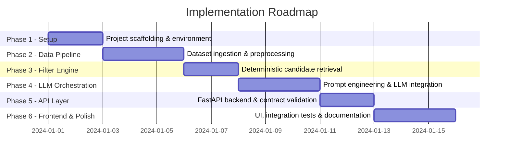

# Implementation Plan: AI-Powered Restaurant Recommendation System

> **Project**: AI-Powered Restaurant Recommendation System (Zomato Use Case)
> **Total Phases**: 6
> **Estimated Duration**: ~3–4 weeks (part-time) / ~10–14 days (full-time)
> **References**: [`problemStatement.md`](./problemStatement.md) · [`architecture.md`](./architecture.md)

---

## Roadmap Overview



---

## Phase 1: Project Setup & Environment Configuration

**Goal**: Establish a clean, reproducible project skeleton with all dependencies and configuration in place before writing functional code.

### 1.1 Repository & Directory Scaffold

Create the full directory structure as defined in [`architecture.md §5`](./architecture.md):

```text
Restaurant Recommendation/
├── data/
│   ├── raw/
│   └── processed/
├── src/
│   ├── __init__.py
│   ├── config.py
│   ├── data/
│   │   ├── __init__.py
│   │   ├── ingest.py
│   │   └── preprocess.py
│   ├── engine/
│   │   ├── __init__.py
│   │   ├── filter.py
│   │   ├── prompt_builder.py
│   │   └── llm_recommender.py
│   ├── api/
│   │   ├── __init__.py
│   │   ├── main.py
│   │   ├── models.py
│   │   └── routes.py
│   └── ui/
│       ├── index.html
│       ├── styles.css
│       └── app.js
├── tests/
│   ├── test_filter.py
│   └── test_api.py
├── docs/
├── .env.example
├── .gitignore
├── requirements.txt
└── README.md
```

### 1.2 Python Environment & Dependencies

**File**: `requirements.txt`

```text
# Core
fastapi>=0.111.0
uvicorn[standard]>=0.29.0
python-dotenv>=1.0.0
pydantic>=2.6.0

# Data Processing
datasets>=2.18.0          # Hugging Face datasets library
pandas>=2.2.0
pyarrow>=15.0.0           # Parquet I/O
duckdb>=0.10.0            # Fast in-process SQL queries

# LLM Orchestration
google-generativeai>=0.5.0   # Gemini API (primary)
openai>=1.20.0               # OpenAI API (fallback)
litellm>=1.35.0              # Unified LLM routing

# Utilities
httpx>=0.27.0
tenacity>=8.2.0           # Exponential backoff / retries

# Testing
pytest>=8.1.0
httpx                     # ASGI test client for FastAPI
```

**Commands**:
```bash
python -m venv .venv
.venv\Scripts\activate       # Windows
pip install -r requirements.txt
```

### 1.3 Configuration & Secrets Management

**File**: `src/config.py`

```python
from pydantic_settings import BaseSettings

class Settings(BaseSettings):
    GEMINI_API_KEY: str = ""
    OPENAI_API_KEY: str = ""
    LLM_PROVIDER: str = "gemini"          # "gemini" | "openai"
    LLM_MODEL: str = "gemini-1.5-flash"
    MAX_CANDIDATES: int = 15
    MAX_LLM_TOKENS: int = 800
    DATASET_ID: str = "ManikaSaini/zomato-restaurant-recommendation"
    PROCESSED_DATA_PATH: str = "data/processed/restaurants.parquet"

    class Config:
        env_file = ".env"

settings = Settings()
```

**File**: `.env.example`
```
GEMINI_API_KEY=your_gemini_api_key_here
OPENAI_API_KEY=your_openai_api_key_here
LLM_PROVIDER=gemini
```

**File**: `.gitignore`
```
.env
.venv/
__pycache__/
data/raw/
data/processed/
*.pyc
```

### ✅ Phase 1 Acceptance Criteria
- [ ] All directories and placeholder files created.
- [ ] `pip install -r requirements.txt` runs without errors.
- [ ] `src/config.py` loads `.env` values correctly via `Settings()`.
- [ ] `.env` is excluded from version control via `.gitignore`.

---

## Phase 2: Data Ingestion & Preprocessing Pipeline

**Goal**: Download the Zomato dataset from Hugging Face, clean and normalize it, and persist a structured Parquet file ready for fast querying.

### 2.1 Dataset Ingestion

**File**: `src/data/ingest.py`

**Tasks**:
- Use the `datasets` library to pull `ManikaSaini/zomato-restaurant-recommendation`.
- Convert the Hugging Face Dataset to a Pandas DataFrame.
- Save raw data to `data/raw/zomato_raw.parquet` as a backup.

```python
from datasets import load_dataset
import pandas as pd

def ingest_dataset(dataset_id: str) -> pd.DataFrame:
    """Download Zomato dataset from Hugging Face and return as DataFrame."""
    dataset = load_dataset(dataset_id, split="train")
    df = dataset.to_pandas()
    df.to_parquet("data/raw/zomato_raw.parquet", index=False)
    return df
```

### 2.2 Data Cleaning & Transformation

**File**: `src/data/preprocess.py`

**Tasks in order**:

| Step | Operation | Detail |
|---|---|---|
| 1 | **Drop duplicates** | On `restaurant_name` + `location` composite key |
| 2 | **Normalize text** | Lowercase city, cuisine, name; strip whitespace |
| 3 | **Parse ratings** | Strip `/5`, coerce to `float`; drop rows where rating is `NaN` |
| 4 | **Parse cost** | Remove `₹`, commas; convert to `int`; fill missing with median per city |
| 5 | **Assign budget tiers** | `Low` < ₹600, `Medium` ₹600–₹1800, `High` > ₹1800 |
| 6 | **Explode cuisines** | Split comma-separated cuisines into a list column for overlap matching |
| 7 | **Compute popularity score** | `score = rating * log1p(votes)` for Bayesian ranking |
| 8 | **Drop invalid rows** | Rows missing `name`, `location`, `rating`, or `cost` |

```python
import pandas as pd
import numpy as np

def preprocess(df: pd.DataFrame) -> pd.DataFrame:
    df = df.drop_duplicates(subset=["name", "location"])
    df["city"] = df["city"].str.strip().str.lower()
    df["cuisines_list"] = df["cuisines"].str.split(",").apply(
        lambda x: [c.strip().lower() for c in x] if isinstance(x, list) else []
    )
    df["rating"] = pd.to_numeric(df["aggregate_rating"], errors="coerce")
    df["cost"] = df["average_cost_for_two"].replace(r"[₹,]", "", regex=True)
    df["cost"] = pd.to_numeric(df["cost"], errors="coerce")
    df["budget_tier"] = pd.cut(df["cost"],
        bins=[0, 600, 1800, float("inf")],
        labels=["Low", "Medium", "High"]
    )
    df["popularity_score"] = df["rating"] * np.log1p(df["votes"].fillna(0))
    df = df.dropna(subset=["name", "city", "rating", "cost"])
    return df

def save_processed(df: pd.DataFrame, path: str):
    df.to_parquet(path, index=False)
```

### 2.3 Data Validation

After preprocessing, verify the output:
- Total record count is reasonable (> 1,000 rows expected).
- No nulls in critical columns (`name`, `city`, `rating`, `cost`, `budget_tier`).
- `cuisines_list` column is a valid Python list on every row.
- `popularity_score` is non-negative and finite.

### ✅ Phase 2 Acceptance Criteria
- [ ] `data/raw/zomato_raw.parquet` exists and is loadable.
- [ ] `data/processed/restaurants.parquet` exists after running the pipeline.
- [ ] No null values in columns: `name`, `city`, `rating`, `cost`, `budget_tier`.
- [ ] `budget_tier` values are strictly `Low`, `Medium`, or `High`.
- [ ] `cuisines_list` is a list column parseable for overlap-based filtering.

---

## Phase 3: Deterministic Candidate Filter Engine

**Goal**: Build a fast, rule-based retrieval engine that narrows down the full restaurant catalog to a focused pool of 10–15 candidates based on the user's hard constraints.

### 3.1 Filter Engine Implementation

**File**: `src/engine/filter.py`

**Filter Logic Chain** (applied in order, each narrows the pool):

```
Entire Catalog (N restaurants)
    │─── Filter: city match (case-insensitive)
    │─── Filter: cuisine overlap (any match)
    │─── Filter: budget_tier match (or ±1 tier tolerance)
    │─── Filter: rating >= min_rating
    │─── Sort:   by popularity_score DESC
    └─── Truncate: top MAX_CANDIDATES (default: 15)
```

```python
import pandas as pd
from src.config import settings

def get_candidates(
    df: pd.DataFrame,
    city: str,
    cuisines: list[str],
    budget: str,
    min_rating: float,
    max_results: int = settings.MAX_CANDIDATES
) -> pd.DataFrame:
    # Step 1: City filter
    mask = df["city"].str.lower() == city.strip().lower()

    # Step 2: Cuisine overlap filter (match any requested cuisine)
    if cuisines:
        cuisine_lower = [c.lower() for c in cuisines]
        mask &= df["cuisines_list"].apply(
            lambda lst: any(c in lst for c in cuisine_lower)
        )

    # Step 3: Budget tier filter (with ±1 tier tolerance)
    budget_order = ["Low", "Medium", "High"]
    if budget in budget_order:
        idx = budget_order.index(budget)
        allowed = budget_order[max(0, idx-1): idx+2]
        mask &= df["budget_tier"].isin(allowed)

    # Step 4: Rating filter
    mask &= df["rating"] >= min_rating

    candidates = df[mask].sort_values("popularity_score", ascending=False)
    return candidates.head(max_results)
```

**Fallback handling** — if a strict filter returns fewer than 3 results:
- Relax cuisine constraint first (return any cuisine in the city+budget+rating combo).
- Relax budget constraint next (±1 tier).
- If still empty, return top-rated restaurants in the city regardless of cuisine.

### 3.2 Metadata Extractor

**File**: `src/engine/filter.py` (additional function)

Used by `GET /api/metadata` to populate frontend dropdowns dynamically from the actual dataset:

```python
def extract_metadata(df: pd.DataFrame) -> dict:
    all_cuisines = sorted(set(
        c for lst in df["cuisines_list"] for c in lst
    ))
    cities = sorted(df["city"].str.title().unique())
    return {
        "cities": cities,
        "cuisines": all_cuisines,
        "budget_tiers": ["Low", "Medium", "High"],
        "rating_range": {"min": 1.0, "max": 5.0}
    }
```

### ✅ Phase 3 Acceptance Criteria
- [ ] `get_candidates()` returns a DataFrame with ≤ `MAX_CANDIDATES` rows.
- [ ] City filter is case-insensitive.
- [ ] Cuisine filter uses list overlap, not exact string match.
- [ ] Budget filter allows ±1 tier tolerance for soft matching.
- [ ] Fallback chain activates when strict filters return fewer than 3 candidates.
- [ ] `extract_metadata()` returns non-empty lists for `cities` and `cuisines`.

---

## Phase 4: LLM Orchestration & Prompt Engineering

**Goal**: Build the AI reasoning layer that transforms a filtered candidate pool + user intent into ranked, explainable restaurant recommendations.

### 4.1 Prompt Template & Context Builder

**File**: `src/engine/prompt_builder.py`

**System Prompt Design Principles**:
1. Persona: "Expert local food concierge"
2. Grounding constraint: "Only recommend from the provided candidate list"
3. Output format: Strictly valid JSON matching the response schema
4. Tone: Warm, concise, personalized

```python
import json
import pandas as pd

SYSTEM_PROMPT = """You are an expert local food concierge with deep knowledge of restaurant culture and dining experiences.

STRICT RULES:
1. You MUST only recommend restaurants from the CANDIDATE LIST provided below.
2. Do NOT invent, fabricate, or suggest venues not present in the candidate list.
3. Your output MUST be valid JSON matching the schema exactly.
4. Rank candidates by how well they match the user's specific context and intent.
5. For each recommendation, write a warm, specific 1-2 sentence explanation of WHY it suits the user.
"""

def build_prompt(candidates: pd.DataFrame, user_request: dict) -> str:
    """Build the LLM prompt with candidate data and user intent."""
    candidate_lines = []
    for _, row in candidates.iterrows():
        candidate_lines.append(
            f"- Name: {row['name']} | Location: {row.get('address', row['city'])} | "
            f"Cuisines: {row['cuisines']} | Rating: {row['rating']}/5 | "
            f"Cost for Two: ₹{int(row['cost'])} | Tier: {row['budget_tier']}"
        )
    candidates_text = "\n".join(candidate_lines)

    user_context = (
        f"City: {user_request['location']}, "
        f"Cuisine Preference: {', '.join(user_request.get('cuisine', ['Any']))}, "
        f"Budget: {user_request['budget']}, "
        f"Minimum Rating: {user_request['min_rating']}/5, "
        f"Additional Context: {user_request.get('context', 'None')}"
    )

    output_schema = json.dumps({
        "query_summary": "<1-sentence summary of the request>",
        "recommendations": [
            {
                "rank": 1,
                "name": "<Restaurant Name>",
                "location": "<Location/Address>",
                "cuisine": "<Cuisines>",
                "rating": 0.0,
                "cost_for_two": "₹XXXX",
                "budget_tier": "<Low|Medium|High>",
                "why_recommended": "<Personalized explanation>",
                "highlights": ["<tag1>", "<tag2>", "<tag3>"]
            }
        ]
    }, indent=2)

    return f"""{SYSTEM_PROMPT}

USER REQUEST:
{user_context}

CANDIDATE LIST:
{candidates_text}

OUTPUT (strict JSON only, no markdown, no extra text):
{output_schema}"""
```

### 4.2 LLM Gateway & Recommender

**File**: `src/engine/llm_recommender.py`

**Tasks**:
- Invoke the configured LLM provider with the built prompt.
- Parse and validate the JSON response against expected schema.
- Implement retry logic with exponential backoff (up to 3 attempts).
- Provide a heuristic fallback if LLM call fails.

```python
import json
import google.generativeai as genai
from tenacity import retry, stop_after_attempt, wait_exponential
from src.config import settings
import pandas as pd

genai.configure(api_key=settings.GEMINI_API_KEY)

@retry(stop=stop_after_attempt(3), wait=wait_exponential(multiplier=1, min=2, max=10))
def call_llm(prompt: str) -> dict:
    """Call Gemini LLM and parse structured JSON response."""
    model = genai.GenerativeModel(
        model_name=settings.LLM_MODEL,
        generation_config={"response_mime_type": "application/json"}
    )
    response = model.generate_content(prompt)
    return json.loads(response.text)

def heuristic_fallback(candidates: pd.DataFrame, max_results: int = 5) -> dict:
    """Return deterministically ranked candidates when LLM is unavailable."""
    top = candidates.head(max_results)
    recommendations = []
    for i, (_, row) in enumerate(top.iterrows()):
        recommendations.append({
            "rank": i + 1,
            "name": row["name"],
            "location": row.get("address", row["city"]),
            "cuisine": row["cuisines"],
            "rating": float(row["rating"]),
            "cost_for_two": f"₹{int(row['cost'])}",
            "budget_tier": str(row["budget_tier"]),
            "why_recommended": f"Highly rated {row['cuisines']} restaurant with a score of {row['rating']}/5.",
            "highlights": []
        })
    return {
        "query_summary": "AI narration unavailable — showing top-rated matches.",
        "recommendations": recommendations
    }

def get_recommendations(prompt: str, candidates: pd.DataFrame) -> dict:
    try:
        result = call_llm(prompt)
        # Guardrail: Validate that returned names exist in candidate pool
        valid_names = set(candidates["name"].str.lower())
        result["recommendations"] = [
            r for r in result["recommendations"]
            if r["name"].lower() in valid_names
        ]
        return result
    except Exception:
        return heuristic_fallback(candidates)
```

### 4.3 Prompt Injection Defense

In `src/engine/prompt_builder.py`, sanitize the free-form `context` field:
```python
import re

def sanitize_input(text: str, max_length: int = 300) -> str:
    """Strip control characters and limit length to prevent prompt injection."""
    text = re.sub(r"[^\w\s,.!?'\"₹-]", "", text)
    return text[:max_length].strip()
```

### ✅ Phase 4 Acceptance Criteria
- [ ] `build_prompt()` generates a well-structured prompt with both candidate data and user context.
- [ ] LLM returns valid JSON parseable by `json.loads()`.
- [ ] Returned recommendation names all exist in the original candidate pool (guardrail check passes).
- [ ] `call_llm()` retries up to 3 times on transient failures.
- [ ] `heuristic_fallback()` activates if all LLM retries fail.
- [ ] `sanitize_input()` strips injection-style special characters.

---

## Phase 5: FastAPI Backend & REST API

**Goal**: Wire all layers together behind a clean, documented REST API with proper request validation, error handling, and CORS support for the frontend.

### 5.1 Pydantic Request & Response Models

**File**: `src/api/models.py`

```python
from pydantic import BaseModel, Field
from typing import Optional
from enum import Enum

class BudgetTier(str, Enum):
    low = "Low"
    medium = "Medium"
    high = "High"

class RecommendRequest(BaseModel):
    location: str = Field(..., min_length=2, max_length=100, example="Bangalore")
    budget: BudgetTier = Field(..., example="Medium")
    cuisine: list[str] = Field(default=[], example=["Italian", "Continental"])
    min_rating: float = Field(default=3.5, ge=1.0, le=5.0, example=4.0)
    context: Optional[str] = Field(default=None, max_length=300,
        example="Quiet romantic dinner with candle-light ambiance")
    max_results: int = Field(default=5, ge=1, le=10)

class RestaurantCard(BaseModel):
    rank: int
    name: str
    location: str
    cuisine: str
    rating: float
    cost_for_two: str
    budget_tier: str
    why_recommended: str
    highlights: list[str]

class RecommendResponse(BaseModel):
    status: str
    query_summary: str
    total_candidates_evaluated: int
    recommendations: list[RestaurantCard]
    fallback_used: bool = False
```

### 5.2 Application Entry Point

**File**: `src/api/main.py`

```python
from fastapi import FastAPI
from fastapi.middleware.cors import CORSMiddleware
from fastapi.staticfiles import StaticFiles
from src.api.routes import router
from src.data.ingest import ingest_dataset
from src.data.preprocess import preprocess, save_processed
from src.config import settings
import pandas as pd
import os

app = FastAPI(
    title="AI Restaurant Recommendation API",
    description="Hybrid LLM-powered restaurant discovery based on Zomato dataset",
    version="1.0.0"
)

app.add_middleware(CORSMiddleware, allow_origins=["*"],
    allow_methods=["*"], allow_headers=["*"])

# Startup: load or build processed dataset
@app.on_event("startup")
async def startup():
    if not os.path.exists(settings.PROCESSED_DATA_PATH):
        raw_df = ingest_dataset(settings.DATASET_ID)
        processed_df = preprocess(raw_df)
        save_processed(processed_df, settings.PROCESSED_DATA_PATH)
    app.state.df = pd.read_parquet(settings.PROCESSED_DATA_PATH)

app.include_router(router, prefix="/api")
app.mount("/", StaticFiles(directory="src/ui", html=True), name="ui")
```

### 5.3 API Routes

**File**: `src/api/routes.py`

| Method | Endpoint | Purpose |
|---|---|---|
| `GET` | `/health` | Liveness probe + dataset record count |
| `GET` | `/api/metadata` | Cities, cuisines, budget tiers for dropdowns |
| `POST` | `/api/recommend` | Main recommendation endpoint |

```python
from fastapi import APIRouter, Request
from src.api.models import RecommendRequest, RecommendResponse
from src.engine.filter import get_candidates, extract_metadata
from src.engine.prompt_builder import build_prompt, sanitize_input
from src.engine.llm_recommender import get_recommendations

router = APIRouter()

@router.get("/health")
async def health(request: Request):
    df = request.app.state.df
    return {"status": "ok", "records": len(df)}

@router.get("/metadata")
async def metadata(request: Request):
    df = request.app.state.df
    return extract_metadata(df)

@router.post("/recommend", response_model=RecommendResponse)
async def recommend(payload: RecommendRequest, request: Request):
    df = request.app.state.df
    if payload.context:
        payload.context = sanitize_input(payload.context)

    candidates = get_candidates(
        df, payload.location, payload.cuisine,
        payload.budget.value, payload.min_rating, payload.max_results
    )

    if candidates.empty:
        return RecommendResponse(
            status="no_results",
            query_summary="No restaurants matched your filters. Try broadening your search.",
            total_candidates_evaluated=0,
            recommendations=[],
            fallback_used=False
        )

    prompt = build_prompt(candidates, payload.dict())
    result = get_recommendations(prompt, candidates)

    return RecommendResponse(
        status="success",
        query_summary=result.get("query_summary", ""),
        total_candidates_evaluated=len(candidates),
        recommendations=result.get("recommendations", []),
        fallback_used="AI narration unavailable" in result.get("query_summary", "")
    )
```

**Run the server**:
```bash
uvicorn src.api.main:app --reload --port 8000
```

### ✅ Phase 5 Acceptance Criteria
- [ ] `GET /health` returns `200 OK` with record count > 0.
- [ ] `GET /api/metadata` returns non-empty lists for `cities` and `cuisines`.
- [ ] `POST /api/recommend` with valid payload returns ranked recommendations.
- [ ] Invalid payload (missing `location` or out-of-range `min_rating`) returns `422 Unprocessable Entity`.
- [ ] CORS headers are present allowing browser requests.
- [ ] FastAPI interactive docs accessible at `http://localhost:8000/docs`.

---

## Phase 6: Frontend UI, Integration Testing & Documentation

**Goal**: Build the interactive web interface, wire it to the API, write integration tests, and finalize project documentation.

### 6.1 Frontend Implementation

**File**: `src/ui/index.html` + `src/ui/styles.css` + `src/ui/app.js`

**UI Sections & Features**:

| Section | Components |
|---|---|
| **Header** | App logo, project name, tagline |
| **Filter Panel** | City dropdown, Cuisine multi-select, Budget toggle (Low/Medium/High), Rating slider (1–5), Free-text "Dining context" input |
| **Search Button** | "Find Restaurants" CTA with loading spinner |
| **Results Grid** | Ranked cards (1–5) displayed in a responsive grid |
| **Restaurant Card** | Rank badge · Name · Location · Cuisine tags · Star rating · Cost for Two · **"AI Why You'll Love This"** explanation · Highlights chips |
| **Empty State** | Friendly illustration + "Broaden your filters" guidance |
| **Fallback Banner** | Subtle notice when heuristic mode is active (no AI) |

**Frontend API Integration** (`app.js`):
```javascript
async function fetchRecommendations(payload) {
    const res = await fetch("/api/recommend", {
        method: "POST",
        headers: { "Content-Type": "application/json" },
        body: JSON.stringify(payload)
    });
    if (!res.ok) throw new Error(`API error: ${res.status}`);
    return res.json();
}

async function loadMetadata() {
    const res = await fetch("/api/metadata");
    const data = await res.json();
    populateCityDropdown(data.cities);
    populateCuisineOptions(data.cuisines);
}
```

**Design Guidelines**:
- Use `Inter` or `Outfit` font from Google Fonts.
- Dark mode as the default theme with an orange/amber accent for food-vibes.
- Rating displayed as filled star icons (★).
- Cuisine labels rendered as rounded chip/badge elements.
- Smooth card entrance animation (`opacity` + `translateY` on load).
- Responsive: single column on mobile, 2–3 column grid on desktop.

---

### 6.2 Integration Tests

**File**: `tests/test_filter.py`

```python
import pandas as pd
import pytest
from src.engine.filter import get_candidates

@pytest.fixture
def sample_df():
    return pd.DataFrame({
        "name": ["Pasta Palace", "Curry House", "Sushi World"],
        "city": ["bangalore", "bangalore", "delhi"],
        "cuisines": ["Italian, Pasta", "North Indian", "Japanese"],
        "cuisines_list": [["italian", "pasta"], ["north indian"], ["japanese"]],
        "rating": [4.5, 4.2, 4.8],
        "cost": [1200, 500, 2500],
        "budget_tier": ["Medium", "Low", "High"],
        "popularity_score": [8.0, 6.0, 9.0]
    })

def test_city_filter(sample_df):
    result = get_candidates(sample_df, "Bangalore", [], "Medium", 3.0)
    assert all(r == "bangalore" for r in result["city"])

def test_cuisine_overlap_filter(sample_df):
    result = get_candidates(sample_df, "bangalore", ["italian"], "Medium", 3.0)
    assert "Pasta Palace" in result["name"].values

def test_min_rating_filter(sample_df):
    result = get_candidates(sample_df, "bangalore", [], "Medium", 4.4)
    assert all(r >= 4.4 for r in result["rating"])

def test_empty_result_when_no_match(sample_df):
    result = get_candidates(sample_df, "mumbai", [], "Medium", 3.0)
    assert result.empty
```

**File**: `tests/test_api.py`

```python
from fastapi.testclient import TestClient
from src.api.main import app
import pandas as pd

client = TestClient(app)

def test_health_endpoint():
    response = client.get("/health")
    assert response.status_code == 200
    assert "records" in response.json()

def test_metadata_endpoint():
    response = client.get("/api/metadata")
    assert response.status_code == 200
    data = response.json()
    assert "cities" in data and len(data["cities"]) > 0
    assert "cuisines" in data and len(data["cuisines"]) > 0

def test_recommend_valid_payload():
    payload = {
        "location": "Bangalore",
        "budget": "Medium",
        "cuisine": ["Italian"],
        "min_rating": 3.5,
        "context": "Romantic dinner",
        "max_results": 3
    }
    response = client.post("/api/recommend", json=payload)
    assert response.status_code == 200
    body = response.json()
    assert body["status"] in ["success", "no_results"]

def test_recommend_invalid_payload():
    payload = {"budget": "Medium"}  # Missing required `location`
    response = client.post("/api/recommend", json=payload)
    assert response.status_code == 422
```

**Run all tests**:
```bash
pytest tests/ -v
```

---

### 6.3 README Documentation

**File**: `README.md`

Sections to include:
1. **Project Overview** — brief description and objectives
2. **Architecture Summary** — link to `architecture.md`
3. **Quick Start**:
   ```bash
   git clone <repo>
   cd "Restaurant Recommendation"
   python -m venv .venv && .venv\Scripts\activate
   pip install -r requirements.txt
   cp .env.example .env   # fill in your API key
   uvicorn src.api.main:app --reload --port 8000
   # Visit http://localhost:8000
   ```
4. **API Reference** — link to auto-generated `/docs` (Swagger UI)
5. **Environment Variables** reference table
6. **Dataset Source** — link to Hugging Face dataset
7. **Testing** — `pytest tests/ -v`

### ✅ Phase 6 Acceptance Criteria
- [ ] UI renders correctly in browser at `http://localhost:8000`.
- [ ] Dropdown menus are dynamically populated from `/api/metadata`.
- [ ] Submitting a valid form returns recommendation cards with AI explanations.
- [ ] Empty state is displayed when no restaurants match the filter.
- [ ] Fallback banner appears when AI explanation is unavailable.
- [ ] All `pytest` tests pass with `0 failures`.
- [ ] `README.md` contains working Quick Start commands.

---

## Summary: Phases & Key Deliverables

| Phase | Focus Area | Key Files Produced | Duration |
|---|---|---|---|
| **Phase 1** | Setup & Config | `requirements.txt`, `config.py`, `.env.example`, `.gitignore` | 1–2 days |
| **Phase 2** | Data Pipeline | `ingest.py`, `preprocess.py`, `restaurants.parquet` | 2–3 days |
| **Phase 3** | Filter Engine | `filter.py` | 1–2 days |
| **Phase 4** | LLM Orchestration | `prompt_builder.py`, `llm_recommender.py` | 2–3 days |
| **Phase 5** | FastAPI Backend | `main.py`, `models.py`, `routes.py` | 1–2 days |
| **Phase 6** | UI, Tests & Docs | `index.html`, `styles.css`, `app.js`, `test_*.py`, `README.md` | 2–3 days |

> **Total Estimated**: 9–15 working days depending on LLM API access and data exploration time.

---

## Risk Register & Mitigations

| Risk | Likelihood | Impact | Mitigation |
|---|---|---|---|
| Dataset schema changes on Hugging Face | Low | High | Cache raw Parquet after first download; pin `datasets` version |
| LLM hallucinating non-existent restaurants | Medium | High | Guardrail: validate returned names against candidate pool names |
| LLM API rate limit or downtime | Medium | Medium | Exponential backoff + heuristic fallback (Phase 4) |
| Empty candidate pool for niche queries | Medium | Medium | Multi-tier fallback relaxation in filter engine (Phase 3) |
| Prompt injection via free-text input | Low | High | `sanitize_input()` strips control/special characters (Phase 4) |
| Frontend-API CORS issues in browser | Low | Medium | CORS middleware enabled globally in `main.py` (Phase 5) |
